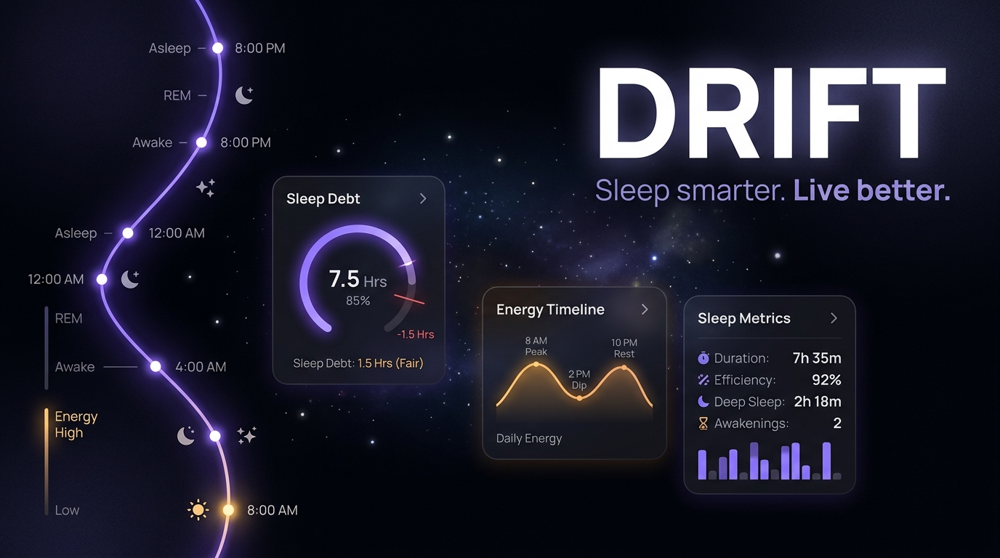

<div align="center">



<br/>

# Drift

**Offline-first Android sleep and energy tracker**


</div>

## Why Drift?

other apps providing the same essentials costs freakin 4k rupees. This app is open source, no internet required, absolutely no ads (coz i dont have google developer account to publish this and monetize thats it XD). Any one can work and raise a pr and ill try my best to resolve them.

Scroll down and read the science if you reallyy want to know that this app does, otw **Good night; sleep well**.

## What Drift does

Drift combines your sleep history with published sleep research to estimate and explain:

* Your daily energy curve
* Sleep debt over the last 14 nights
* Personalized sleep need
* Circadian phase and chronotype
* Sleep regularity
* Caffeine cutoff and light exposure timing
* Wind-down timing
* Nap windows
* Ideal sleep and wake timing

Data can come from Health Connect, Sleep as Android, or on-device phone detection.

## Screens

| Tab          | Key content                                                                |
| ------------ | -------------------------------------------------------------------------- |
| **Sleep**    | Sleep debt, last night, 14-night history, sleep need, regularity, tonight  |
| **Energy**   | 36-hour energy timeline, sleep editing, habit markers, melatonin window    |
| **Progress** | Night-by-night sleep times, debt history, morning quality                  |
| **Learn**    | Sleep science, body clock, and explanations of how Drift calculates things |

Every screen handles loading, first use, insufficient data, ready, source problems, and error states.

## The Science

The goal is not to throw arbitrary numbers at you.

The analysis engine is a pure Kotlin library. Given the same inputs and engine version, it produces the same outputs.

Current models include:

### Energy Curve

A three-process model combining:

* Homeostatic sleep pressure
* Circadian rhythm
* Sleep inertia

### Sleep Need

A 1-D Kalman filter estimates individual sleep need from free nights and adjusts for rebound from accumulated sleep debt.

### Sleep Debt

Sleep debt uses a leaky 14-night accumulator that allows debt to build up and recover gradually rather than treating every night independently.

### Circadian Phase

DLMO is estimated from habitual sleep timing and used to estimate circadian phase, melatonin timing, and appropriate sleep timing.

More detailed methodology and references are available inside the app under **Learn → How Drift calculates**.

## Privacy

Drift has **no INTERNET permission**.

There is:

* No network connection
* No analytics SDK
* No crash reporter
* No account
* No login
* No cloud sync
* No advertising

Sleep data is stored locally in an encrypted SQLCipher database, with the encryption key stored in Android Keystore.

Your data does not leave your phone.

## Open Source

The project is open source because I want people to be able to inspect how the app works instead of blindly trusting an algorithm that produces a number.

If you find a bug, disagree with an implementation, want to improve the analysis, or want to add a feature, open an issue or submit a PR.

Anyone can work on Drift.

## Architecture

```text
Source Adapters
       |
       v
:core:data
       |
       v
:core:engine
       |
       v
AnalysisSnapshot
       |
       +------> Sleep
       +------> Energy
       +------> Progress
       +------> Reminders
       +------> Widget
```

The analysis engine contains no Android or I/O dependencies.

### Main modules

| Module                   | Purpose                                           |
| ------------------------ | ------------------------------------------------- |
| `:core:model`            | Domain models and contracts                       |
| `:core:engine`           | Pure Kotlin sleep analysis engine                 |
| `:core:data`             | Database, repositories, merging and deduplication |
| `:source:healthconnect`  | Health Connect integration                        |
| `:source:sleepasandroid` | Sleep as Android integration                      |
| `:source:phone`          | On-device sleep detection                         |
| `:core:background`       | Background processing and notifications           |
| `:core:designsystem`     | UI design system                                  |
| `:core:charts`           | Custom Compose charts                             |
| `:feature:energy`        | Energy screen                                     |
| `:feature:sleep`         | Sleep analysis screens                            |
| `:feature:onboarding`    | Onboarding and permissions                        |
| `:feature:settings`      | Settings and data management                      |
| `:app`                   | Application wiring                                |

## Tech Stack

| Concern     | Technology                              |
| ----------- | --------------------------------------- |
| Language    | Kotlin 2.2                              |
| UI          | Jetpack Compose                         |
| DI          | Hilt                                    |
| Storage     | Room + SQLCipher + DataStore            |
| Background  | WorkManager                             |
| Health data | Health Connect                          |
| Time        | `java.time`                             |
| Widget      | Jetpack Glance                          |
| Testing     | JUnit 5, Kotest, Robolectric, Roborazzi |
| Build       | Gradle + Android Gradle Plugin          |

## Building

### Requirements

* JDK 21
* Android SDK
* WSL / Ubuntu 24.04 recommended

```bash
source scripts/env.sh

./gradlew assembleDebug
```

Run the project checks:

```bash
./gradlew driftChecks
```

Run the analysis engine tests:

```bash
./gradlew :core:engine:test
```

## Testing

The analysis engine has:

* Golden tests
* Property tests
* Scenario fixtures
* Deterministic output checks
* Timezone-shift tests
* DST transition tests
* Duplicate-source tests
* Missing-data scenarios

The goal is simple:

```text
same input + same engine version = same output
```

Changes to the analysis engine should be intentional and testable.

## Data Sources

| Source               | Description                                                          |
| -------------------- | -------------------------------------------------------------------- |
| **Health Connect**   | Sleep sessions, stages, HR, HRV and steps                            |
| **Sleep as Android** | Health Connect sync, CSV import and tracking data                    |
| **Phone detection**  | Uses on-device signals to reconstruct sleep                          |
| **boAt ring**        | Supported through Health Connect when the boAt app writes data there |

Different sources are merged and deduplicated locally. User edits always take priority.

## License

MIT © 2026 Krish Gopi

## Contributing

Found something wrong?

Open an issue.

Want to improve something?

Open a PR.

Want to completely change how something works?

Open a PR and explain why.

The project is open source. The code, algorithms and assumptions should be inspectable by anyone who cares to look.

<div align="center">

**Good night; sleep well**

</div>
